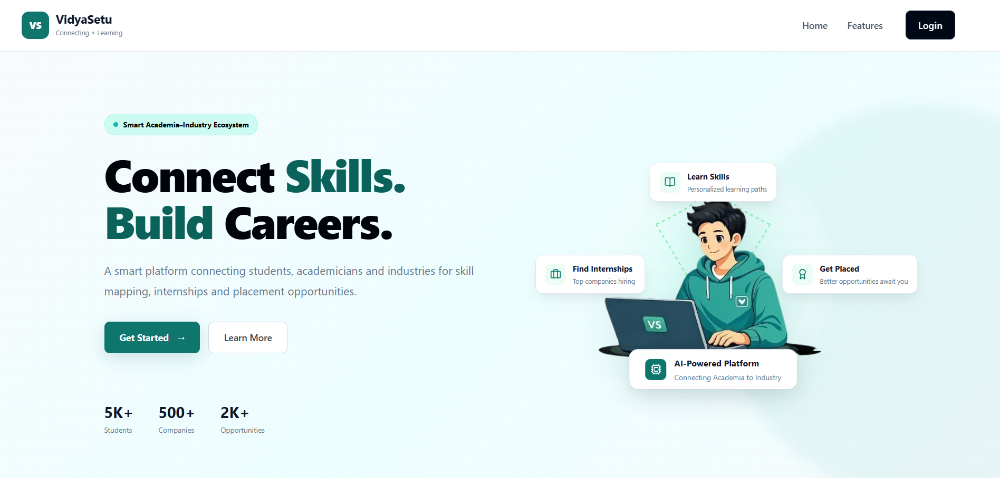
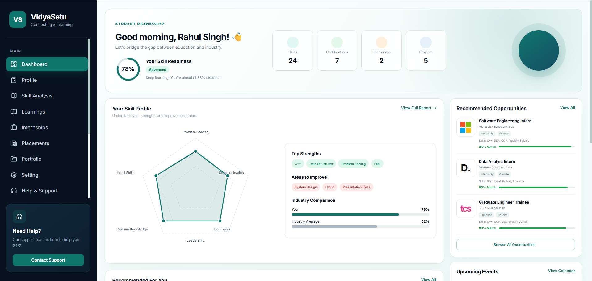
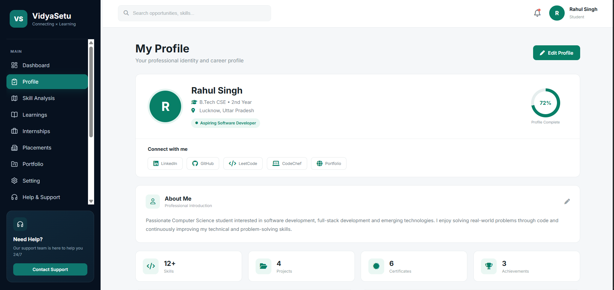
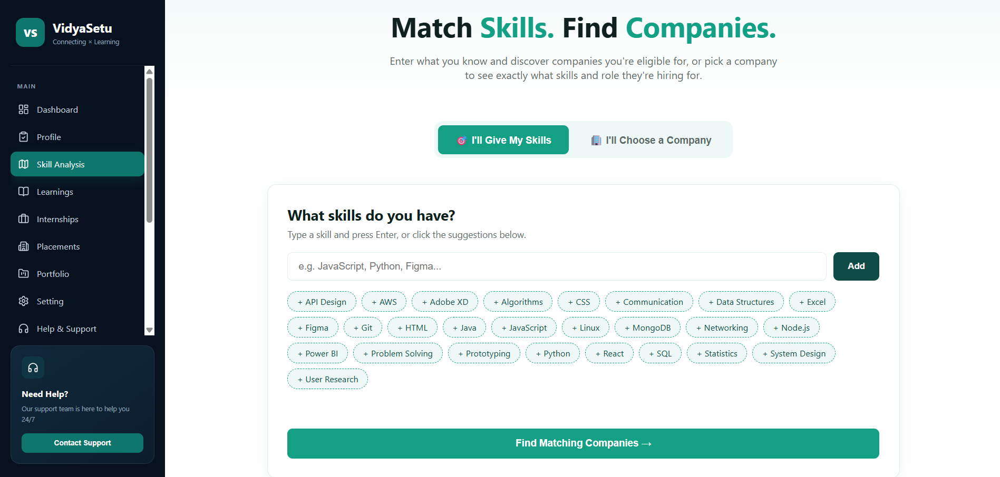
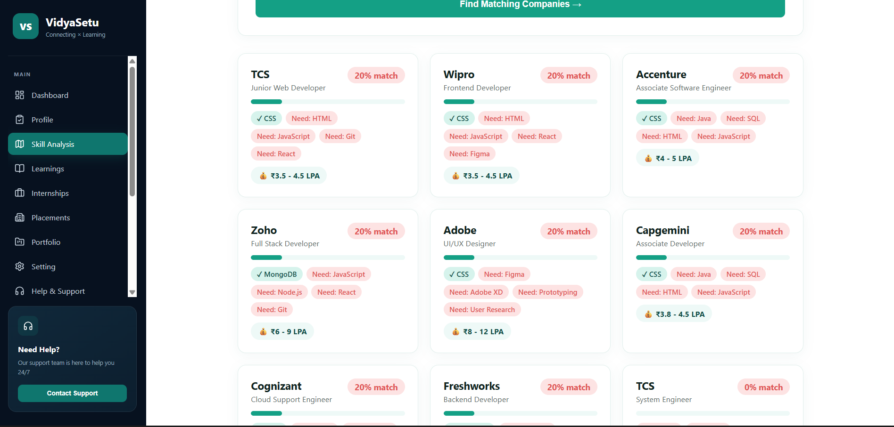
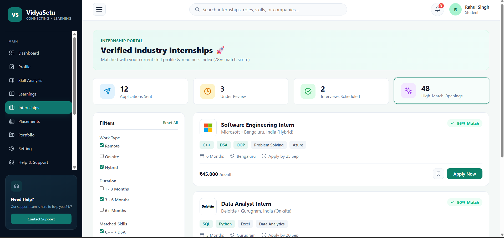
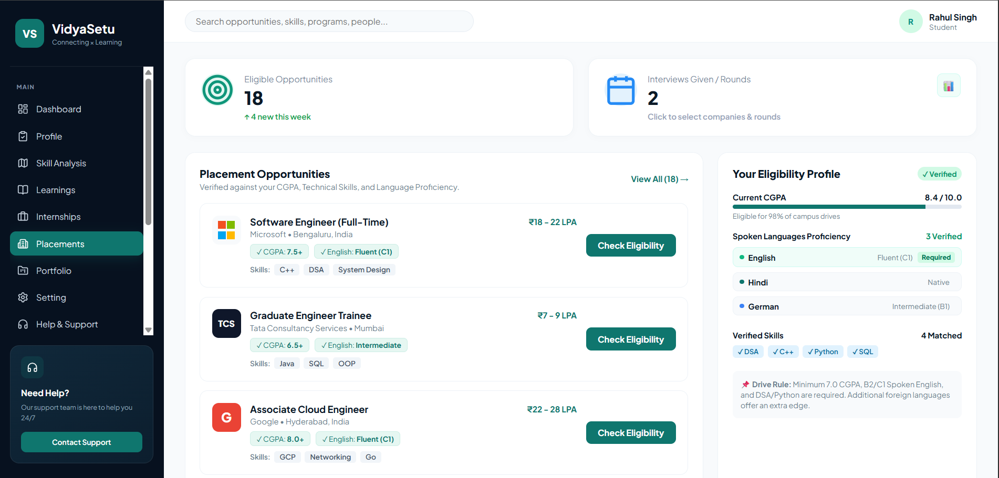

[README (1).md](https://github.com/user-attachments/files/32926505/README.1.md)
<div align="center">

# 🎓 VidyaSetu

### Connect Skills. Build Careers.

A smart academia–industry platform that connects **students**, **academicians** and **companies** through skill mapping, internships and placement opportunities.


[Live Demo](#) · [Report Bug](#) · [Request Feature](#)



</div>

---

## 📑 Table of Contents

- [About the Project](#-about-the-project)
- [Problem Statement](#-problem-statement)
- [Key Features](#-key-features)
- [Screenshots](#-screenshots)
- [User Roles](#-user-roles)
- [Tech Stack](#-tech-stack)
- [Getting Started](#-getting-started)
- [Project Structure](#-project-structure)
- [Roadmap](#-roadmap)
- [Team Syntax Squad](#-team-syntax-squad)
- [License](#-license)

---

## 📖 About the Project

**VidyaSetu** (*Vidya* = knowledge, *Setu* = bridge) is a web platform built for the **Smart India Hackathon (SIH)**. It gives students one place to understand their skills, find where they fit in the industry, and apply for internships and placements, while companies and academicians stay connected to the same ecosystem.

## 🎯 Problem Statement

Many students graduate without knowing which skills the industry actually needs, companies struggle to find well-matched candidates, and institutions have little visibility into industry expectations.

VidyaSetu solves this by:

- Mapping student skills against real company requirements
- Showing students exactly which skills they are missing
- Verifying eligibility (CGPA, technical skills, language proficiency) before applying
- Connecting students, academicians and companies on a single platform

## ✨ Key Features

| Feature | Description |
|---------|-------------|
| 📊 **Student Dashboard** | Skill readiness score, skill radar chart, strengths, areas to improve and industry comparison |
| 👤 **Professional Profile** | Skills, projects, certificates, achievements and links to GitHub, LinkedIn, LeetCode and CodeChef |
| 🧠 **Skill Analysis** | Enter your skills and find matching companies, or pick a company and see the exact skills required |
| 💼 **Internship Portal** | Verified internships with match score, filters (work type, duration, skills) and one-click apply |
| 🏢 **Placement Portal** | Placement drives with eligibility check against CGPA, technical skills and spoken languages |
| 📚 **Learnings** | Learning paths to close identified skill gaps |
| 🗂 **Portfolio** | Showcase projects and achievements to recruiters |
| 🔔 **Notifications & Support** | Opportunity alerts and 24/7 help and support |

## 🖼 Screenshots

### Student Dashboard
Skill readiness, radar chart, top strengths, areas to improve and recommended opportunities.



### Profile
Professional identity with skills, projects, certificates and coding profile links.



### Skill Analysis
Pick your skills or choose a company, and get matched instantly.

| Enter Skills | Matching Companies |
|--------------|--------------------|
|  |  |

### Internships
Verified internships with match percentage and smart filters.



### Placements
Eligibility check based on CGPA, skills and language proficiency.



## 👥 User Roles

**🎒 Student**
- Build a profile and add skills, projects and certificates
- Analyse skill gaps and find matching companies
- Apply for internships and placements

**🎓 Academician**
- Track student skill readiness
- Guide students toward the right learning paths

**🏢 Company**
- Post internships and placement drives
- Discover candidates by skill match

## 🛠 Tech Stack

> Replace this list with the technologies you actually used.

- **Frontend:** HTML, CSS, JavaScript
- **Backend:** Node.js / Express
- **Database:** MongoDB
- **Hosting:** Vercel / Netlify

## 🚀 Getting Started

### Prerequisites

- [Node.js](https://nodejs.org/) v18 or above
- npm
- Git

### Installation

```bash
# 1. Clone the repository
git clone https://github.com/your-username/vidyasetu.git

# 2. Go to the project folder
cd vidyasetu

# 3. Install dependencies
npm install

# 4. Create your environment file
cp .env.example .env

# 5. Start the development server
npm start
```

Open **http://localhost:3000** in your browser.

### Environment Variables

```env
PORT=3000
DATABASE_URL=your_database_url
```

## 📂 Project Structure

```
vidyasetu/
├── public/          # Static files (images, icons)
├── Screenshot/     # README screenshots
├── src/
│   ├── pages/       # Landing, Dashboard, Profile, Skill Analysis, Internships, Placements
│   ├── components/  # Reusable UI components
│   ├── styles/      # CSS files
│   └── scripts/     # JavaScript logic
├── .env.example
├── package.json
└── README.md
```

## 🗺 Roadmap

- [x] Landing page and teal-dark UI design
- [x] Student dashboard with skill readiness
- [x] Profile and portfolio pages
- [x] Skill analysis (skills → companies)
- [x] Internship and placement portals
- [ ] Company and academician dashboards
- [ ] Training programs
- [ ] Live location tracking
- [ ] AI-based skill recommendations

## 🤝 Team Syntax Squad

| # | Name |
|---|------|
| 1 | Rahul Singh |
| 2 | Saniya Khatoon |
| 3 | Krishna Kumar Gupta |
| 4 | Soham Shukla |
| 5 | Abhay Kumar |
| 6 | Prashant Singh |

Built for **Smart India Hackathon (SIH)** at **Shri Ramswaroop Memorial University (SRMU)**.

## 📄 License

Distributed under the MIT License. See `LICENSE` for more information.

---

<div align="center">

⭐ If you like this project, give it a star!

</div>
